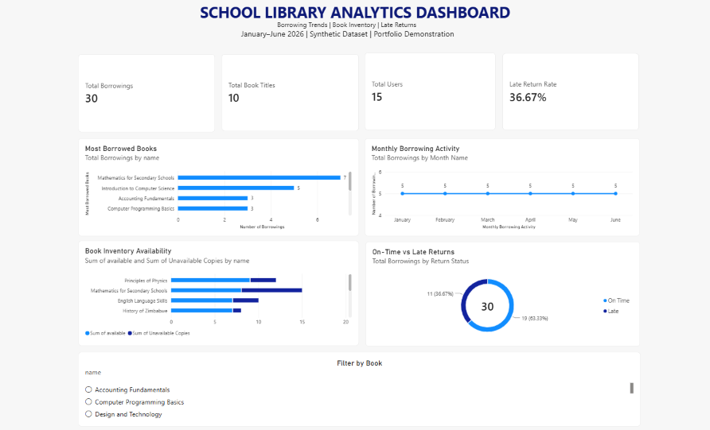
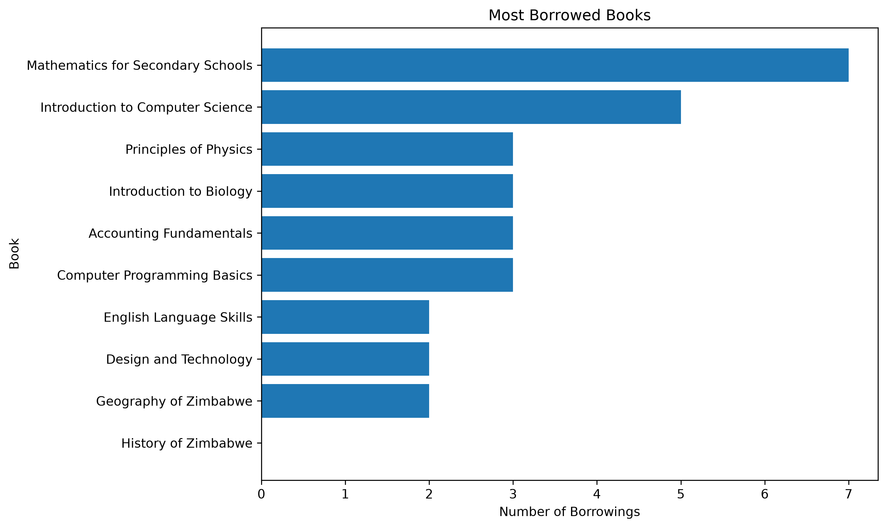
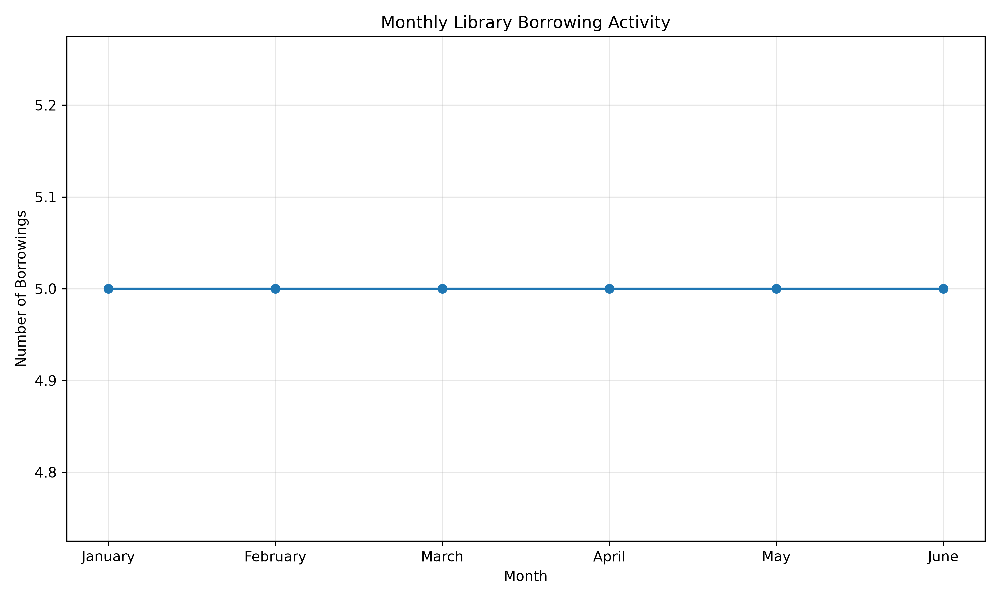
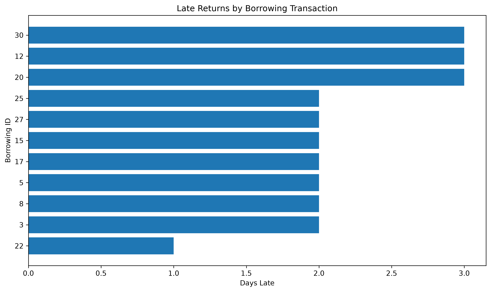
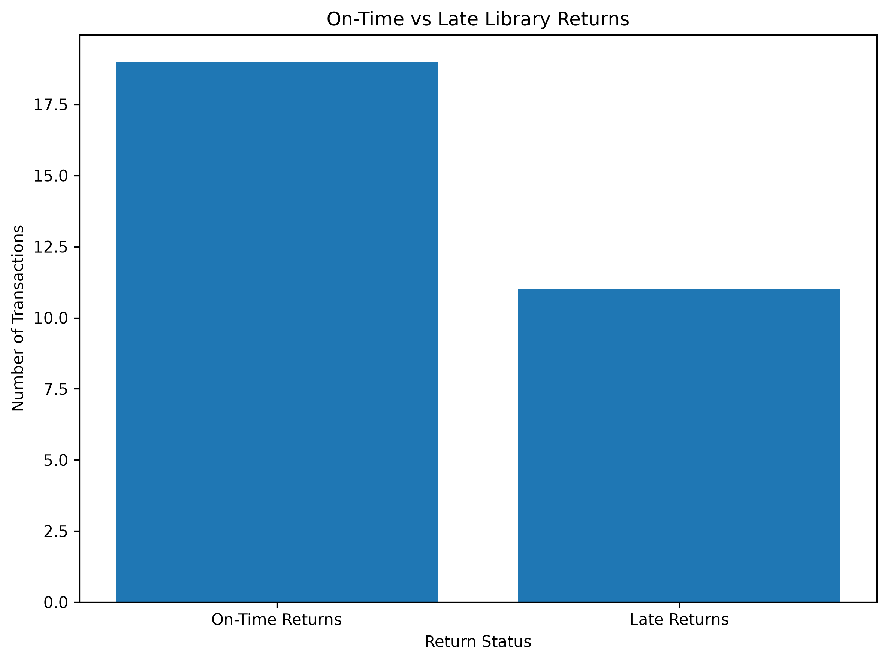

# School Library Data Analytics

### An End-to-End Data Analytics Portfolio Project

**Python | Pandas | SQL | MySQL | Matplotlib | Power BI | Git & GitHub**

## Project Overview

School libraries manage textbooks, borrowing transactions, inventory availability and book returns. Analysing this information can help librarians understand borrowing patterns, identify frequently requested textbooks and improve inventory planning.

This project demonstrates an end-to-end data analytics workflow using Python, SQL and Power BI to explore library borrowing activity and generate actionable insights.

The analysis covers **January–June 2026** and uses a synthetic dataset containing:

- **10** book titles
- **15** library users
- **30** borrowing transactions

**Dataset disclaimer:** All records are synthetic and were created for learning and portfolio demonstration. They do not represent actual school library transactions.

## Power BI Dashboard

An interactive Power BI dashboard was developed to communicate key findings through performance indicators, charts and filters.



[**View Power BI Dashboard File**](powerbi/School_Library_Analytics.pbix)

### Dashboard Features

- **Key Performance Indicators:** Total borrowings, book titles, users and late return rate.
- **Most Borrowed Books:** Identifies textbooks with the highest borrowing frequency.
- **Monthly Borrowing Activity:** Tracks borrowing transactions from January to June 2026.
- **Book Inventory Availability:** Compares available and unavailable copies.
- **On-Time vs Late Returns:** Visualises borrowing transactions by return status.
- **Interactive Book Filter:** Enables exploration of individual book titles.

### Key Performance Indicators

| KPI | Result |
|---|---:|
| Total Borrowing Transactions | 30 |
| Total Book Titles | 10 |
| Total Library Users | 15 |
| Late Returns | 11 |
| On-Time Returns | 19 |
| Late Return Rate | 36.67% |

## Business Problem

Library managers need accurate information to understand how textbooks are used, monitor availability and identify borrowing patterns.

Without effective analysis, decisions about inventory, overdue returns and resource allocation may rely on assumptions rather than evidence.

This project explores how data analytics can support informed library management decisions.

## Project Objectives

1. Identify the most frequently borrowed textbooks.
2. Identify books with low borrowing activity.
3. Analyse monthly borrowing patterns.
4. Calculate the frequency of late returns.
5. Examine user borrowing activity.
6. Evaluate textbook inventory availability.
7. Generate recommendations based on the analytical findings.

## Tools and Technologies

| Technology | Application |
|---|---|
| Python | Data analysis and processing |
| Pandas | Data manipulation, joins, aggregation and date calculations |
| Matplotlib | Creating analytical charts |
| MySQL | Relational database management |
| SQL | Querying and analysing borrowing records |
| phpMyAdmin | Database administration and CSV imports |
| Power BI | Interactive dashboard development |
| DAX | Calculated measures and performance indicators |
| Git & GitHub | Version control and project documentation |
| VS Code | Python development and project management |

## Dataset Description

The project uses three CSV files.

### 1. Books — `data/books.csv`

Contains textbook inventory information.

| Column | Description |
|---|---|
| book_id | Unique textbook identifier |
| name | Textbook title |
| author | Author's name |
| publisher | Publisher |
| quantity | Total copies recorded |
| available | Copies currently available in the sample inventory |

### 2. Users — `data/users.csv`

Contains synthetic library user information.

| Column | Description |
|---|---|
| user_id | Unique user identifier |
| name | User name |
| role | User role |

### 3. Borrowings — `data/borrowings.csv`

Contains borrowing transaction records.

| Column | Description |
|---|---|
| borrowing_id | Unique transaction identifier |
| user_id | Borrowing user's identifier |
| book_id | Borrowed textbook identifier |
| borrow_date | Date the textbook was borrowed |
| due_date | Expected return date |
| date_returned | Actual return date |

## Project Methodology

The project follows a structured data analytics workflow.

### Step 1: Data Collection

Three synthetic CSV datasets were prepared to represent library inventory, users and borrowing transactions.

### Step 2: Data Cleaning and Preparation

Using Python and Pandas, the datasets were examined for:

- Missing values
- Duplicate records
- Data types
- Date formatting
- Borrowing durations
- Late return durations

The provided sample data contained no missing values or duplicate records.

Date columns were converted into datetime values, and additional analytical fields were calculated.

**Days Borrowed**

`days_borrowed = date_returned - borrow_date`

**Days Late**

`days_late = max(0, date_returned - due_date)`

The cleaning script is available at:

[`python/data_cleaning.py`](python/data_cleaning.py)

### Step 3: SQL Analysis

The CSV data was imported into MySQL and analysed using SQL queries.

Seven analytical queries were developed to investigate:

1. Most borrowed books
2. Low-utilisation books
3. Monthly borrowing activity
4. Late returns
5. Most active users
6. Late return rate as a potential penalty indicator
7. Book demand and inventory availability

The SQL analysis demonstrates the use of:

- `SELECT`
- `LEFT JOIN`
- `GROUP BY`
- `ORDER BY`
- `COUNT()`
- `SUM()`
- `CASE`
- `DATEDIFF()`
- `ROUND()`

[**View SQL Analysis Queries**](sql/analysis_queries.sql)

### Step 4: Python Data Analysis

Pandas was used to analyse borrowing frequency, user activity, late returns and inventory availability.

The analysis involved grouping records, joining datasets, sorting results and calculating percentage-based indicators.

[**View Python Analysis Script**](python/analysis.py)

### Step 5: Data Visualisation

Matplotlib was used to generate four analytical charts.

**Most Borrowed Books**



**Monthly Borrowing Activity**



**Late Returns by Transaction**



**On-Time vs Late Returns**



### Step 6: Power BI Dashboard Development

The three datasets were loaded into Power BI Desktop.

Relationships were established between the books, users and borrowings tables using their corresponding identifiers.

DAX measures and calculated fields were used to support reporting, including total borrowing transactions, book titles, users, late return rate, return status and inventory availability.

The dashboard combines summary metrics, borrowing trends, inventory comparisons and interactive filtering.

## Key Findings

### 1. Most Borrowed Books

| Book Title | Borrowing Transactions |
|---|---:|
| Mathematics for Secondary Schools | 7 |
| Introduction to Computer Science | 5 |
| Principles of Physics | 3 |
| Introduction to Biology | 3 |
| Accounting Fundamentals | 3 |
| Computer Programming Basics | 3 |

**Insight:** Mathematics for Secondary Schools had the highest borrowing frequency, accounting for approximately 23.33% of the 30 transactions.

### 2. Low-Utilisation Books

History of Zimbabwe recorded **zero borrowing transactions** during the analysed period.

English Language Skills, Geography of Zimbabwe and Design and Technology each recorded two transactions.

**Insight:** Low borrowing frequency may justify further investigation into textbook visibility, curriculum relevance or user interest.

### 3. Monthly Borrowing Activity

| Month | Transactions |
|---|---:|
| January 2026 | 5 |
| February 2026 | 5 |
| March 2026 | 5 |
| April 2026 | 5 |
| May 2026 | 5 |
| June 2026 | 5 |

**Insight:** The synthetic dataset shows a constant borrowing frequency of five transactions per month. It does not demonstrate seasonal variation.

### 4. Late Return Analysis

Out of 30 borrowing transactions:

- 19 were returned on time.
- 11 were returned late.
- The late return rate was 36.67%.
- Late transactions accumulated 24 overdue days.
- The average delay among late returns was approximately 2.18 days.

**Insight:** Late returns accounted for more than one-third of borrowing transactions in the sample data.

### 5. User Borrowing Activity

All 15 users recorded two borrowing transactions each.

**Insight:** Borrowing activity was evenly distributed among the synthetic users, so the sample does not identify any particularly active individual borrower.

### 6. Inventory Availability

| Book Title | Total Copies | Available Copies | Unavailable Copies |
|---|---:|---:|---:|
| Computer Programming Basics | 8 | 2 | 6 |
| Accounting Fundamentals | 10 | 3 | 7 |
| Introduction to Biology | 12 | 4 | 8 |
| Mathematics for Secondary Schools | 15 | 8 | 7 |
| Introduction to Computer Science | 10 | 6 | 4 |

**Insight:** Computer Programming Basics had the highest unavailable-copy percentage among the analysed titles, at 75%.

Inventory availability represents the sample's recorded stock position. It should not be interpreted as a historical measure of demand or proof that additional copies are required.

### 7. Potential Penalty Indicator

The dataset does not contain actual penalty records or monetary charges.

For demonstration purposes, late returns were treated as transactions that could potentially result in penalties.

Therefore, the calculated 36.67% represents a **late return rate**, not a verified financial penalty rate.

## Recommendations

Based on the synthetic dataset, the following actions could be considered in a real library setting.

**1. Monitor High-Demand Textbooks**

Review borrowing frequency and availability for Mathematics for Secondary Schools and other frequently borrowed titles before making purchasing decisions.

**2. Improve Due-Date Reminders**

Introduce automated notifications before borrowing deadlines to help reduce overdue returns.

**3. Investigate Low-Utilisation Textbooks**

Examine the visibility, relevance and accessibility of textbooks with low borrowing activity.

**4. Monitor Inventory Availability**

Regularly compare available and unavailable copies to identify titles that may require closer monitoring.

**5. Expand the Analysis Period**

Analyse a larger dataset covering multiple academic terms or years to identify meaningful borrowing trends and seasonal patterns.

## Project Structure

```text
school-library-data-analytics/
│
├── data/
│   ├── books.csv
│   ├── users.csv
│   └── borrowings.csv
│
├── python/
│   ├── data_cleaning.py
│   └── analysis.py
│
├── sql/
│   └── analysis_queries.sql
│
├── visualisations/
│   ├── popular_books.png
│   ├── monthly_borrowings.png
│   ├── late_returns.png
│   └── penalties.png
│
├── powerbi/
│   ├── dashboard.png
│   └── School_Library_Analytics.pbix
│
├── .gitignore
├── requirements.txt
└── README.md
```

## How to Run the Project

### Prerequisites

- Python 3
- Git
- MySQL (optional for SQL analysis)
- Power BI Desktop (optional for viewing or editing the dashboard)

### 1. Clone the Repository

```bash
git clone https://github.com/kbcalvin/school-library-data-analytics.git
cd school-library-data-analytics
```

### 2. Create a Virtual Environment

```powershell
python -m venv .venv
```

Activate the environment in Windows PowerShell:

```powershell
.\.venv\Scripts\Activate.ps1
```

### 3. Install Dependencies

```powershell
python -m pip install -r requirements.txt
```

### 4. Run the Data Cleaning Script

```powershell
python python/data_cleaning.py
```

### 5. Run the Analysis Script

```powershell
python python/analysis.py
```

The analysis script prints the results and generates visualisations in the `visualisations/` folder.

Run the commands from the project root directory.

### 6. Explore the SQL Queries

Create a MySQL database containing the `books`, `users` and `borrowings` tables, then import the supplied CSV files.

Import the data in this order:

1. `books.csv`
2. `users.csv`
3. `borrowings.csv`

The borrowing table references the book and user identifiers.

Run the queries in [`sql/analysis_queries.sql`](sql/analysis_queries.sql) to reproduce the SQL analysis.

### 7. Open the Power BI Dashboard

Open the following file using Power BI Desktop:

`powerbi/School_Library_Analytics.pbix`

If Power BI cannot locate the source CSV files after cloning the repository, update their paths in Power Query to point to the local `data/` directory and refresh the model.

## Future Improvements

- Add automated data validation and quality checks.
- Create reusable cleaned datasets.
- Add a SQL database setup script.
- Expand the dataset across multiple academic years.
- Introduce more advanced Power BI measures and drill-through reporting.
- Automate data refresh and reporting workflows.
- Investigate additional inventory utilisation metrics.

## Skills Demonstrated

This project demonstrates practical experience in:

- Data cleaning and preparation
- Exploratory data analysis
- SQL querying and relational joins
- Data aggregation and statistical summaries
- Data visualisation
- Power BI dashboard development
- DAX calculations
- Business problem-solving
- Translating analytical results into recommendations
- Technical documentation
- Git and GitHub version control

## Author

**Kudakwashe Calvin Bamusi**

BSc Information Technology Graduate | Aspiring Data Analyst

**GitHub:** [github.com/kbcalvin](https://github.com/kbcalvin/)

**Email:** kbcalvin27@gmail.com

---

*This project was developed for educational purposes and to demonstrate practical data analytics skills using synthetic school library data.*